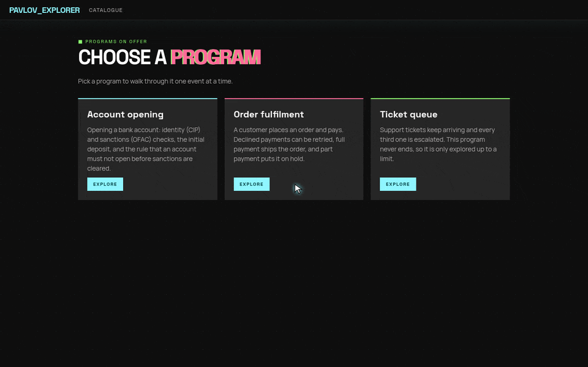

# Pavlov: Behavioral Programming for Clojure

Pavlov is an opinionated [behavioral programming](https://cacm.acm.org/research/behavioral-programming/) library for Clojure(Script). Behavioral programming was invented by David Harel. It has a solid theoretical foundation and is radically simple in principle.

Pavlov provides the following benefits:

- Decoupled units of behavior. Bthreads only communicate via events.
- Append-only programming. Changes to the behavior of a program can be done by adding bthreads rather than rewriting existing code.
- Model checking for free. The same code written for production runs in the model checker.

Differences from existing behavioral programming libraries:

- Pavlov takes a functional, data-first approach, rather than the imperative style used by [BPjs](https://bpjs.readthedocs.io/en/latest/BPjsTutorial/hello-world.html#hello-block-world)
- Pavlov encourages [scenario-based programming](https://link.springer.com/book/10.1007/978-3-642-19029-2) as the go-to default for bthreads

## Design Goals

1. *Zero core dependencies*. Pavlov's core has 0 dependencies. Pavlov devtools has dependencies, but is used only during development and testing
2. *Cross Platform* - JVM, CLJS, Babashka, and (experimental) Squint support
3. *First class model checking*. Pavlov's programs can be used by its model checker - for free. No translating between TLA+, Spin, etc. See [Pavlov model checking](./modules/pavlov-skills/skills/pavlov-model-checking/SKILL.md).
4. *Interactive program inspection*. Support `nav` so that tools like `portal` can inspect execution branches of a behavioral program. See [Navigating Behavioral Programs](./doc/navigating-bprograms.md).

## Modules

| Module | Status | Version |
|--------|--------|---------|
| core   | stable   | [](https://clojars.org/tech.thomascothran/pavlov) |
| devtools | beta | [](https://clojars.org/tech.thomascothran/pavlov-devtools) |
| skills | pre-alpha | [](https://clojars.org/tech.thomascothran/pavlov-skills) |
| web | pre-alpha | [](https://clojars.org/tech.thomascothran/pavlov-web) |
| explorer | pre-alpha | not yet released |


## Getting Started

### Understand Behavioral Programming
To understand pavlov, you must understand behavioral programming. The best introduction is the article [Behavioral Programming, by David Harel, Assaf Marron, and Gera Weiss](https://cacm.acm.org/research/behavioral-programming/). It is very accessible, and the explanation provided there is a prerequisite for the rest of this README.

### Programming with Scenarios
Pavlov encourages you to program in scenarios, and pavlov composes them for you. Let's take a simple, canonical example using an industrial process. You need three parts hot water and three parts cold water.

First, we need some bthreads. Behavioral programming uses a basic unit called a bthread (for "behavioral thread"). Bthreads encapsulate behaviors.  They park until events to which they are subscribed occur.

Bthreads are composed in a behavioral program. Here is a simple example:

```clojure
(ns water-controls.app
  (:require [tech.thomascothran.pavlov.bthread :as b]
            [tech.thomascothran.pavlov.bprogram.ephemeral :as bpe]))

;; bthreads are stateful, so always use a constructor
(defn hot-water
  []
  (b/scenario [{:request #{:hot-water}}
               {:request #{:hot-water}}
               {:request #{:hot-water}}]))

(defn cold-water
  []
  (b/scenario [{:request #{:cold-water}}
               {:request #{:cold-water}}
               {:request #{:cold-water}}]))

;; Run an ephemeral bprogram
@(bpe/execute! {:hot-water (hot-water)
                :cold-water (cold-water)}
              {:subscribers ;; functions that receive every event
               {:logger (fn [event _] (println event))}})

;; :hot-water
;; :hot-water
;; :hot-water
;; :cold-water
;; :cold-water
;; :cold-water
;; {:type :tech.thomascothran.pavlov.bprogram.ephemeral/deadlock, :terminal true}
```

When no more events can be selected, the bprogram emits a terminal deadlock event and stops.

Simple enough. But then you discover a new rule: hot and cold water must alternate. The temperature needs to be relatively consistent or the tank will be damaged.

Usually, you need to modify the existing code to add this new requirement. But with behavioral programming, you can use an *append only* programming style:

```clojure
(defn interleave-hot-and-cold
  []
  (b/scenario [{:wait-on #{:cold-water}
                :block #{:hot-water}} ;; <- block :hot-water until :cold-water
               (fn [_]                         ;; scenario takes either a literal
                 {:bid {:wait-on #{:hot-water} ;; map or a function.
                        :block #{:cold-water}}
                  :next-step :first})])) ;; <- restart at the top after hot water


@(bpe/execute! {:hot-water (hot-water)
                :cold-water (cold-water)
                :interleave-hot-and-cold    ;; the only change to
                (interleave-hot-and-cold)}  ;; existing code!
              {:subscribers {:logger (fn [event _] (println event))}})

;; :cold-water
;; :hot-water
;; :cold-water
;; :hot-water
;; :cold-water
;; :hot-water
;; {:type :tech.thomascothran.pavlov.bprogram.ephemeral/deadlock, :terminal true}
```

You should be familiar with the idea of requesting, waiting, and blocking events from the article [Behavioral Programming, by David Harel, Assaf Marron, and Gera Weiss](https://cacm.acm.org/research/behavioral-programming/). For a deeper introduction to the lifecycle of bthreads and how bids work, see [What is a bthread?](./doc/what-is-a-bthread.md). To explore groups of bthreads interactively, see [Navigating Behavioral Programs](./doc/navigating-bprograms.md).

## Scenario
The vast majority of the time, you will only need the `scenario` bthread constructor. A scenario is just a linear sequence.

We already saw this example:

```clojure
(defn hot-water
  []
  (b/scenario [{:request #{:hot-water}}
               {:request #{:hot-water}}
               {:request #{:hot-water}}]))
```

We call the map with the `:request`, `:wait-on`, or `:block` keys a bid.

Events can also be maps. The following are equivalent:

```clojure
:hot-water
{:type :hot-water}
```

In addition to taking maps for its steps, `scenario` can also take functions:

```clojure
(defn hot-water
  []
  (b/scenario [(fn [{_ :event, state :state}]
                 {:bid {:request #{:hot-water}}
                  :state (update state :ounces inc)})
               (fn [{_ :event, state :state}]
                 {:bid {:request #{:hot-water}}
                  :state (update state :ounces inc)})
               (fn [{_ :event, state :state}]
                 {:bid {:request #{:hot-water}}
                  :state (update state :ounces inc)})]
              {:initial-state {:ounces 0}}))
```

Functions receive both the triggering event and the bthread's state. A function updates that state by returning a `:state` value alongside `:bid`.

Because `scenario` is linear, it reads a lot like a test scenario. This is intentional!

It is often useful to shut down a bthread when specified events occur. This can be done with the `:until` parameter:

```clojure
(defn hot-water
  []
  (b/scenario [{:request #{:hot-water}}
               {:request #{:hot-water}}
               {:request #{:hot-water}}]
              {:until #{:shutdown}}))
```

If the shutdown event occurs, then the bthread will shut down.

Sequences passed to `scenario` will be realized, so do not pass infinite sequences.

Scenario has a few more capabilities (such as restarting at its first step). See its docstring for details.

## Bprograms
Bthreads are assembled into bprograms. The main purpose of a behavioral program is to select the next event, and notify all bthreads subscribed to that event. A bthread is subscribed to an event if it requested that exact event (compared with `=`), or if it is waiting on the event's type. See [What is a bthread?](doc/what-is-a-bthread.md#how-events-are-matched) for the matching rules.

To run an ephemeral bprogram, use one of the two main API functions in `tech.thomascothran.pavlov.bprogram.ephemeral`:

- `execute!`: returns a promise that is delivered when the bprogram terminates with the value of the terminal event. It allows you to call a bprogram like a function. By default it terminates on deadlock; pass `{:terminate-on-deadlock false}` to wait for external events or asynchronous IO outcomes instead. In that mode, use explicit terminal events and optionally `:kill-after` to bound execution.
- `make-program!`: returns the bprogram itself. This lets you send it new events from the outside (i.e., not from bthreads).

Bprograms have a simple algorithm for selecting the next event.

### Event Selection Rules

The bprogram will select an event according to the following rules:

1. Find the highest priority bthread which has requested at least one unblocked event
2. Select the highest priority event requested by that bthread

Bprograms use Clojure's collection semantics to determine priority order. Unordered collections (maps for bthreads and sets for requested events) have a non-deterministic priority. In most cases this is fine.

However, ordered collections (a sequence of bthread name, bthread pairs for bthreads; or a vector for requested events) can be used to impose a deterministic priority order.

## Internal and External Events

All events requested by bthreads will be handled before external events.

This means that when an event is submitted to the bprogram, bthreads are notified, and any events they request are processed repeatedly until there are no outstanding requested events.

At that point in time, the next external event will be processed.

## Bthreads can spawn other bthreads

Bthreads are stateful. They can run in parallel and be parked when they are waiting on events.

The bid a bthread produces can request events, wait on events, or block events in other bthreads. Bthreads do not directly know about each other.

Bids may also spawn child bthreads via `:bthreads`. Spawned bthreads are keyed by name and initialized by being notified with a `nil` event. If spawned during init, they can observe the first event; if spawned in response to an event, they only observe subsequent events.

```clojure

(b/scenario [(fn [_]
               {:request #{:a}
                :bthreads {:child (b/scenario [{:request #{:b}}])}})])
```

Watch out! Bthreads are stateful, and so using a literal bid with `:bthreads` should be avoided.

```clojure

(b/scenario [{:request #{:a}
              :bthreads {:child (b/scenario [{:request #{:b}}])}}])
```

This will cause the model checker to malfunction, because the bthread will have stale state.

## Bthread constructors
`scenario` is the default way to create bthreads, and will likely be the best choice for 90% of the bthreads you need. However, in some cases, a different constructor can be useful:

### Literal map
This is a bthread that always requests `:fireworks`

```clojure
{:request #{:fireworks}}
```

### `repeat`
If you want to set the fireworks off 10,000 times, you can use `repeat`:

```clojure
(b/repeat
  10000
  {:request #{:fireworks}})     ;; <- this event is requested 10000 times
```

### `after-all`
Use `after-all` when you want to wait on a set of prior events, regardless of the order they occur in.

```clojure
(require '[tech.thomascothran.pavlov.bthread :as b])

(defn order-ready
  [order-id]
  (b/after-all #{:payment/authorized :packing/completed}
               (fn [events]
                 {:request #{{:type :order/ready
                              :order/id order-id
                              :sources (mapv :type events)}}})))

;; Your bprogram will call notify!, your application code will not call
;; notify! directly. But notify! can be used at the REPL to see what
;; the bthread does.

(let [order-ready-bthread (order-ready 42)]
  (b/notify! order-ready-bthread nil)
  ;; => {:wait-on #{:packing/completed :payment/authorized}}

  (b/notify! order-ready-bthread {:type :payment/authorized :order/id 42})
  ;; => {:wait-on #{:packing/completed :payment/authorized}}

  (b/notify! order-ready-bthread {:type :packing/completed :order/id 42}))
  ;; => {:request #{{:type :order/ready
  ;;                 :order/id 42
  ;;                 :sources [:payment/authorized :packing/completed]}}}
```

### Extensibility

Bthreads, bids, and behavioral programs are all protocols, allowing you to extend each as needed.

## Recipes

### Request an event once

The simplest way to request an event is by its name:

```clojure
{:request #{:a}}
```

The bid protocol is extended to Clojure maps. This results in a bthread that will always request `:a`.

Perhaps you just want to request `:a` once.


```clojure
(b/scenario [{:request #{:a}}])
```

This bthread requests `:a` once. Then the bthread terminates.

Note that `:a` and `{:type :a}` are different events. They share the type `:a`, so they match the same waits and blocks, but a request for one is not satisfied by the other.

### Add more data to an event

Events can also be maps.

For example:

```clojure
{:type :submit
 :form {:first-name "Thomas"}}
```

All bthreads that subscribe to `:submit` events now have access to the form data as well.

### Block until

Combine `:wait-on` and `:block`:

```clojure
(b/scenario [{:wait-on #{:b}
              :block #{:c}}])
```

Event `:c` is blocked until `:b` occurs. Then the bthread terminates.

### Cancel `x` when `y` occurs

Combine `:wait-on` and `:request`:

```clojure
(defn bthread-one
  []
  (b/scenario [{:wait-on #{:b}
                :request #{:a}}]))

(defn bthread-two
  []
  (b/scenario [{:block #{:a}
                :wait-on #{:c}}]))
```

`bthread-two` blocks event `:a`.

If event `:c` occurs first, then `:a`'s request will succeed. (Assuming it is not blocked by other bthreads.)

However, if event `:b` occurs before event `:c`, then `:a` is cancelled.

### Terminate the bprogram

When `:c` occurs, close the program.

```clojure
(b/scenario [{:wait-on #{:c}}
             {:request #{{:type :finis
                          :terminal true}}}])
```

### Request events with a fallback

```clojure
(defn make-bthread-one
  []
  (b/scenario [{:request [:a :b]}]))

(defn make-bthread-two
  []
  {:block #{:a}})
```

Bthread one will request `:a`, but if `:a` is blocked, fall back to `:b`. (Ordered collections establish priority.)

### Target responses

Often the same bthread will publish events to many bthreads, but you don't want all those bthreads to have to handle every response.

For example, suppose you have a bthread that listens for a `find-user` event, finds the user (say from a database), and then requests an event with the user details. If the `find-user` bthread simply produces a `user-found` or `user-not-found` event, then *any* bthread that looks up users might receive that event - whether they requested the user or not!

Instead, the `find-user` event can carry an `:on-success` argument:

```clojure
{:type :find-user
 :user-id 1
 :on-success :membership.user-found.1}
```

The `find-user` bthread can then use `:membership.user-found.1` as the event type for the user details. This allows you to target the resulting events.

Often, you don't want to do blocking IO in bthreads. The same pattern works with something like the IO subscriber.

## Subscribers

Subscribers are functions that are called on every event. They are useful for logging and development tools. They may also be used for IO when you want to keep the bprogram itself pure. (However, depending on the use case, IO in bthreads can be fine.)

Subscribers may be passed in when the bprogram is created:

```clojure
(require '[tech.thomascothran.pavlov.bthread :as b])
(require '[tech.thomascothran.pavlov.bprogram :as bp])
(require '[tech.thomascothran.pavlov.bprogram.ephemeral :as bpe])
(require '[clojure.pprint :refer [pprint]])

(def subscribers
  {:logger (fn [event bprogram]
             (pprint {:event event
                      :bthread->bid (bp/bthread->bids bprogram)}))})

@(bpe/execute!
   [[:bthread-1 (b/scenario [{:request #{:event-a}}])]
    [:bthread-2 (b/scenario [{:request #{:event-b}}])]]
   {:subscribers subscribers})
```

See the namespace `tech.thomascothran.pavlov.subscribers.tap` in the devtools module for an implementation of a subscriber.

## Understanding Program Execution

It may seem that behavioral programming makes programs both harder to reason about and harder to visualize as they execute. In fact, the opposite is the case.

The pavlov devtools module is provided to help you visualize and understand program execution.

### Pavlov Explorer

Pavlov Explorer is a browser tool for walking a behavioral program one event at a time. It is meant for people who do not read the code, such as product managers. At each step you see what can happen next, the trace that led there, and the alternatives you could have taken instead. You can go back, switch to an alternative, and open a view of what each bthread is requesting, waiting for and blocking, including its source code.



The explorer explores programs the same way the model checker does: you give it a catalogue of programs, each described by a model-check config. See the [explorer module README](./modules/pavlov-explorer/README.md) to get started.

### Pavlov Program Navigator (Portal Integration)

The Pavlov Program Navigator is a visual exploration tool that connects your behavioral programs (bthreads) in Clojure with Portal, allowing you to walk through possible execution paths—including branching decisions and history—click by click.

For example, a tic-tac-toe behavioral program can be viewed as a graph that begins with 9 edges representing the 9 choices that player `x` might make. Click on one of those choices, and now you have 8 edges representing player `o`'s choices.

At each step of the program execution, you can see:

- What the available branches are (what possible events may be emitted)
- What the state of each bthread is
- The history of events that led to this program state
- The bids from all bthreads

See [Navigating Behavioral Programs](./doc/navigating-bprograms.md) for a walkthrough.

### Visualizing program execution

Despite the ability to run concurrently, every step in the bprogram's execution is deterministic and auditable. Each bthread submits a bid, and the logic for selecting a bid is straightforward: the highest priority unblocked event is selected (see [Event Selection Rules](#event-selection-rules)).

`pavlov`'s bprogram takes functions in the `subscribers` options map, which are invoked on each sync point.

The functions in `subscribers` are invoked with two arguments: the selected event and the bprogram. Use `tech.thomascothran.pavlov.bprogram/bthread->bids` to get a map of each bthread to its bid.

A `tap` subscriber is implemented in `tech.thomascothran.pavlov.subscribers.tap` (devtools module). This subscriber shows, on each sync:

- What event was selected
- What event types are blocked
- What events were requested, and which of them are not blocked
- What event types are being waited on
- A map of bthreads to bids
- A map of requested events, waited-on types, and blocked types to bthreads


Here is an example of how the tap subscriber can be used with [portal](https://github.com/djblue/portal).

```clojure
(require '[portal.api :as portal])
(require '[tech.thomascothran.pavlov.bthread :as b])
(require '[tech.thomascothran.pavlov.subscribers.tap :as taps])
(require '[tech.thomascothran.pavlov.bprogram.ephemeral :as bpe])

;; Set up portal
(def p (portal/open))
(add-tap #'portal/submit)

;; Run the program
@(bpe/execute!
   [[:bthread-1 (b/scenario [{:request #{:event-a}}])]
    [:bthread-2 (b/scenario [{:request #{:event-b}}])]]
   {:subscribers {:tap taps/subscriber}}) ;; <- add the tap
```

## Experimental Squint support

Pavlov core and the browser-facing parts of Pavlov Web can be compiled with
[Squint](https://github.com/squint-cljs/squint). The implementation and tests
are shared with full ClojureScript; Squint-specific files only configure test
and ESM entrypoints.

```bash
cd modules/pavlov
npm ci && npm run test:squint

cd ../pavlov-web
npm ci && npm run test:squint

cd ../../examples/web
npm ci && npm run build:squint
```

The example server exposes the Squint bundle at `/browser-only-squint` and
`/game-of-life-squint`; the original Shadow CLJS pages remain at
`/browser-only` and `/game-of-life`. Squint consumes Pavlov source roots rather
than Clojars JARs. A consuming monorepo can configure paths directly:

```clojure
{:paths ["src"
         "../pavlov/modules/pavlov/src"
         "../pavlov/modules/pavlov-web/src"]}
```

Support remains experimental and currently inherits Pavlov core's primitive
string/keyword bthread-name and event-type profile. Collection-valued names or
event types are not yet guaranteed under Squint.

Squint's `=` compares objects without their own equality, such as `reify`
events, by their fields rather than by identity, which affects which requests
an event satisfies. See
[How events are matched](doc/what-is-a-bthread.md#how-events-are-matched).


## Further Reading

- [Behavioral Programming](https://cacm.acm.org/research/behavioral-programming/), by David Harel, Assaf Marron, and Gera Weiss (2012)
- [The Behavioral Programming Web Page](https://www.wisdom.weizmann.ac.il/~bprogram/more.html)
- [Programming Coordinated Behavior in Java](https://www.wisdom.weizmann.ac.il/~/bprogram/pres/BPJ%20Introduction.pdf) by David Harel, Assaf Marron, and Gera Weiss.
- [Documentation and Examples for BPJ](https://wiki.weizmann.ac.il/bp/index.php/User_Guide)

## License

Copyright © 2025–2026 Thomas Cothran

Distributed under the Eclipse Public License version 1.0.
